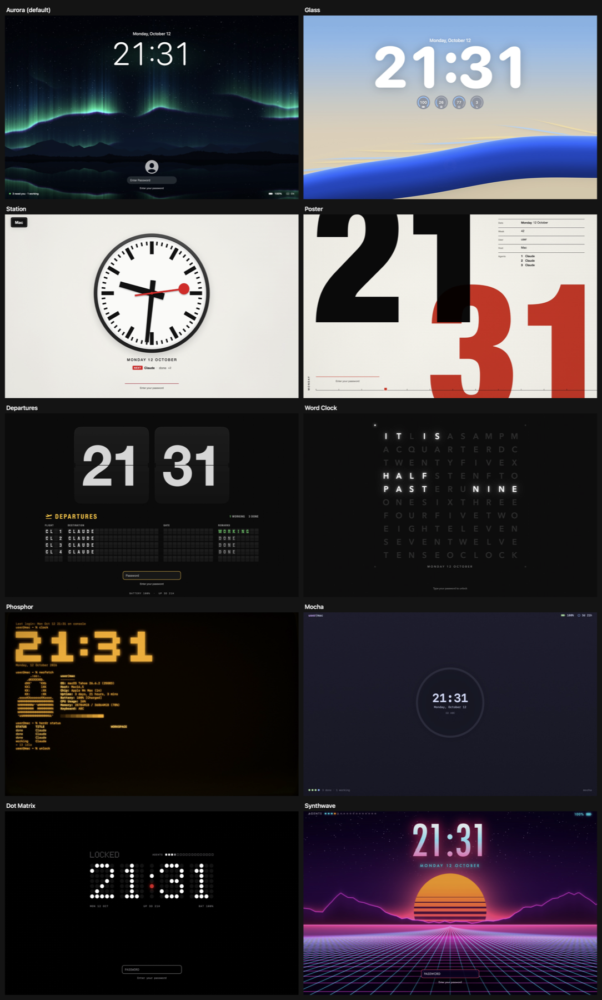

# Locky

A lock screen for macOS that you build like a Neovim config: themes and widgets are Lua plugins, drawn
natively with SwiftUI and Metal.

> Locky unlocks only with Touch ID or your login password. While it shows, the macOS lock screen is off; if
> Locky crashes, hangs, or is killed, a guard process turns the macOS lock screen on, and ⌃⌥⌘Q switches to it.
> [security.md](docs/security.md) says what Locky guarantees and what it does not.

## Build

```sh
Scripts/package_app.sh            # builds Locky.app and installs it in /Applications
open Locky.app                    # the lock icon appears in the menu bar
swift test                        # the test suite
```

A build is signed ad hoc unless a `signing.env` next to `Package.swift` (ignored by git) names a certificate, for
example `SIGNING_MODE=dev` and `APP_IDENTITY="Developer ID Application: Your Name (TEAMID)"`. macOS ties
permissions such as Accessibility to the signature, so an ad-hoc build asks for them again after each build.

The first launch opens the Welcome, three short pages:

1. **Welcome to Locky:** your lock screen, live. Lock Now tries a real lock.
2. **Make Locky Your Lock Screen:** turn on Lock automatically, Open at login, and a Lock Now shortcut, so that
   Locky locks your Mac. Lock with the Touch ID button makes that button show Locky too. The Apple menu's Lock
   Screen and ⌃⌘Q still show the macOS lock screen.
3. **If Something Goes Wrong:** what happens if Locky stops during a lock, and the ⌃⌥⌘Q way out
   ([security.md](docs/security.md#if-something-goes-wrong)).

Help › Welcome to Locky opens it again. The menu bar icon has Lock Now, Themes…, and Settings….

## Themes



Twenty-eight themes ship with Locky. Each is a package in `Sources/Locky/Resources/packages/<id>/` (Aurora, the
default, lives in the core runtime) with its own widgets, shaders, and a README with its options. The last eight
are live wallpapers, after the most popular scenes on Wallpaper Engine's Steam Workshop, drawn entirely in Metal.

| Theme | id | Look |
|---|---|---|
| Aurora | `default` | Northern lights over mountains and a still lake; a thin clock. |
| Glass | `glass` | Your wallpaper, a huge clock, and glass gauges; the password field appears when you type. |
| Station | `station` | A Swiss railway clock on warm gray, with a platform sign and your next "departure". |
| Poster | `poster` | International Typographic Style: giant cropped hours, red minutes overprinting them. |
| Departures | `departures` | A flip clock and a split-flap board of your herdr agents. |
| Word Clock | `wordclock` | An 11×10 letter grid that spells the time (English). |
| Phosphor | `phosphor` | An amber CRT terminal: shell session, block clock, system info, scanlines. |
| Mocha | `mocha` | Catppuccin Mocha with an i3lock-style ring around the clock. |
| Dot Matrix | `dotmatrix` | A 5×7 dot-matrix clock on a ghost grid, with one red accent. |
| Synthwave | `synthwave` | A neon sunset over a perspective grid, with a chrome clock. |
| Tokyo Night | `tokyonight` | The hyprlock look: hours over minutes in two colors, status in the corners. |
| Gruvbox | `gruvbox` | A conky sidebar of system stats beside a big clock, in Gruvbox colors. |
| Observatory | `observatory` | Stars and the Milky Way over a dome; tonight's moon and the sun's path. |
| Mission | `mission` | Flight control: mission elapsed time, clocks, telemetry, and progress rings. |
| Pocket | `pocket` | A handheld LCD game: a pixel clock, hearts, a score, and the Game of Life. |
| Bauhaus | `bauhaus` | A 1923 poster in primary shapes; a notch in the red circle sweeps the seconds. |
| Memento | `memento` | Day 286 of 365: a dot for every day of the year, and a stoic quote. |
| Rainy | `rainy` | Rain sliding down a window over city lights; the time in words. |
| Matrix | `matrix` | Digital rain, a glowing clock, and "Wake up, Neo…" typed in the corner. |
| Notebook | `notebook` | A ruled notebook page: your todo.txt by hand, a sticky note, a coffee ring. |
| Event Horizon | `eventhorizon` | A black hole's turning accretion disk, its light bent around the shadow. |
| Galaxy Sea | `galaxysea` | The Milky Way mirrored in a calm sea, a small boat on the horizon, meteors. |
| Liquid | `liquid` | Color folding into color like silk; a big clock and a row of glass widgets. |
| Neon City | `neoncity` | A rainy city at 2 AM: towers drifting past, neon signs, a neon clock. |
| Sakura | `sakura` | A cherry branch under the moon, falling petals, the month's old Japanese name. |
| Deep Blue | `deepblue` | Underwater light rays and plankton, and a humpback gliding past. |
| Lookout | `lookout` | Firewatch-style ridges and a fire lookout, lit by the real time of day. |
| Snowfall | `snowfall` | Snow falling on a pine forest at night, a cabin with warm windows. |

Pick one in the Themes window (the menu bar icon's Themes…), or in `init.lua` with
`locky.setup({ theme = "station" })`. `Scripts/snapshot.sh <id> out.png [1728x1117]` renders any theme to a PNG.
To make your own, see [create-theme.md](docs/create-theme.md).

## The windows

Themes… in the menu bar icon's menu opens the **Themes** window: the theme in use, live, and every theme as a
picture. Click one to use it, or use the arrow keys. File › New Theme… (⌘N) starts a theme of your own.
Customize… edits it on its live lock screen (drag widgets, add them from a live gallery, change their options, the
background, the colors, the font, and where the password field sits). Schedule (the
clock in the toolbar, or File › Schedule Themes…) changes the theme by time of day or with Light and Dark mode, and
Move to Trash removes a theme you made.

Settings… (⌘,) opens the **Settings** window. General holds the Lock Now shortcut, Lock with the Touch ID button, auto-lock, Open at login, a lock
screen message, Hide personal information, Lock animation (seven styles, with a preview), Turn the display off,
Touch ID, and a photo after wrong passwords.
Plugins installs, updates, and removes plugins. General's last section opens the config folder and init.lua, shows
init.lua's problems, and makes new themes and widgets. Everything but Open at login saves to `~/.config/locky/settings.json`, which wins over init.lua
key by key: see [settings.md](docs/settings.md).

## Configure

`~/.config/locky/init.lua` (Settings › General › Config folder creates it with examples):

```lua
locky.setup({ theme = "default", palette = { accent = "#ff79c6" } })
locky.pack.add({ "someone/locky-weather" })
```

The same binary is a command line (`Locky.app/Contents/MacOS/Locky`):

```
locky check [--theme NAME] [--widget NAME]   run your config, plugins, and a theme; list every error
locky render --theme NAME --out FILE.png     the lock screen as a PNG, without a window; also --widget NAME,
                                             --size 1728x1117, --appearance light|dark,
                                             --transition lock|unlock --at 0.5 (the lock's animation),
                                             --style focus (or fade, iris, lift, sweep, dissolve, tiles)
locky health                                 like :checkhealth
locky themes | widgets                       what is installed
locky skill install | path                   Locky's skill for coding agents (docs/agents.md)
locky pack list|sync|update|clean            plugins from git, pinned by locky-pack-lock.json
locky pack check                             which plugins have updates; installs none
locky login [on|off]                         open Locky at login, or not
locky preview --theme NAME                   the lock screen in a window; --transition [STYLE] plays
                                             the lock's animation (Return plays it again)
locky window [SECTION]                       the Themes window, a Settings pane, or the Welcome
```

## Make your own

- [create-widget.md](docs/create-widget.md): write a widget, check it, draw it, and put it on the lock screen.
- [agents.md](docs/agents.md): have a coding agent, such as Claude Code or Codex, write widgets and themes for you.

## Docs

- [plugins.md](docs/plugins.md): the plugin system, widgets, packages, health, and the safety rules
- [views.md](docs/views.md): every view and property widgets can draw
- [widgets.md](docs/widgets.md): the core widgets and their options
- [create-theme.md](docs/create-theme.md): make a theme in the Themes window or in Lua, and share it
- [themes.md](docs/themes.md): themes, backgrounds, and shaders
- [api.md](docs/api.md): the `locky` API
- [settings.md](docs/settings.md): settings.json, which the windows write, and how it layers over init.lua
- [security.md](docs/security.md): what the lock guarantees, what it does not, and how to report a vulnerability

## Layout

```
Sources/CLua/                 Lua 5.5.1 (unmodified) and locky_bridge.c: time budgets, memory limit, safe calls
Sources/Locky/Lua/            the runtime: LuaVM, LuaRuntime, the runtime path, system information
Sources/Locky/Views/          views, themes, backgrounds, widget hosts, the password field
Sources/Locky/Window/         the Themes window (the gallery and Customize), the Settings window (General, Plugins),
                              the Welcome
Sources/Locky/Settings/       settings.json, its store, and the theme schedule
Sources/Locky/System/         the shortcut, auto-lock, login item, power, camera, editors, and the guard's Locky side
Sources/GuardCore/            the guard's watch and the macOS lock screen call, shared by Locky and locky-guard
Sources/LockyGuard/           locky-guard, which locks the Mac if Locky dies or hangs during a lock
Sources/Locky/Resources/
  runtime/                    lua/locky (core, ui), plugin/ (core widgets), themes/, shaders/, types/
  packages/                   the built-in theme packages, one folder each
Scripts/                      packaging, snapshot.sh (a theme to PNG), window-shot.sh (a window to PNG),
                              thumbnails.sh (the theme thumbnails), make_icon.swift (the app icon)
Tests/LockyTests/             the test suite
```
