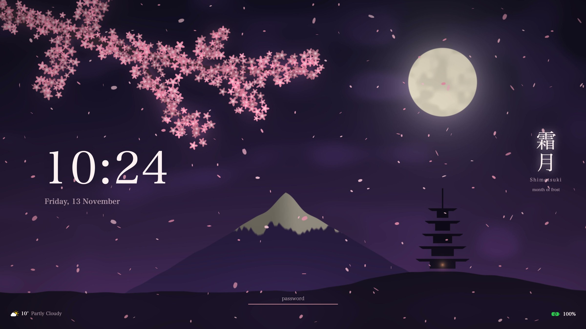
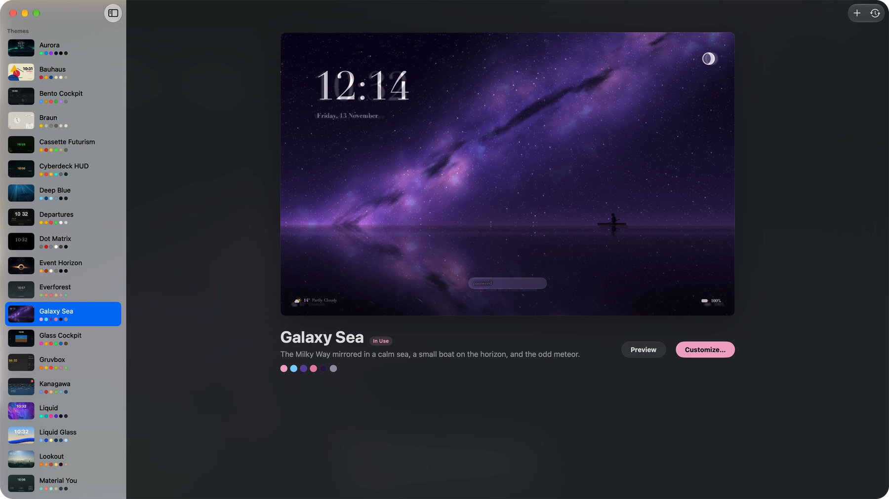
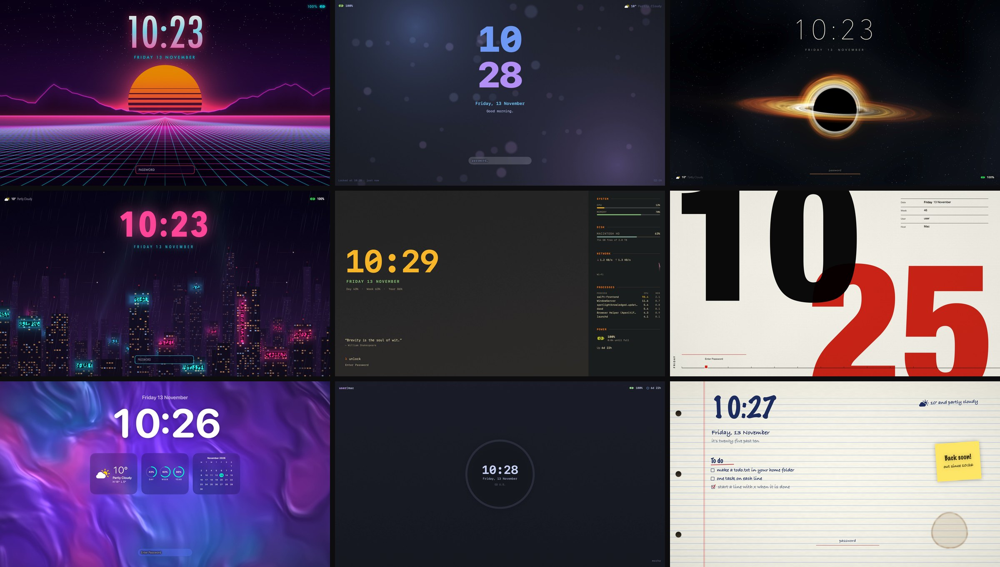
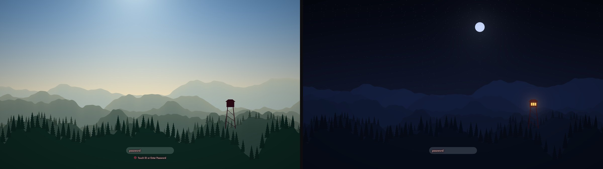
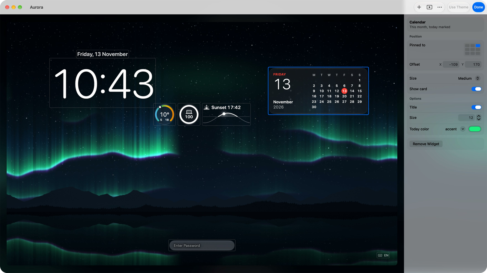
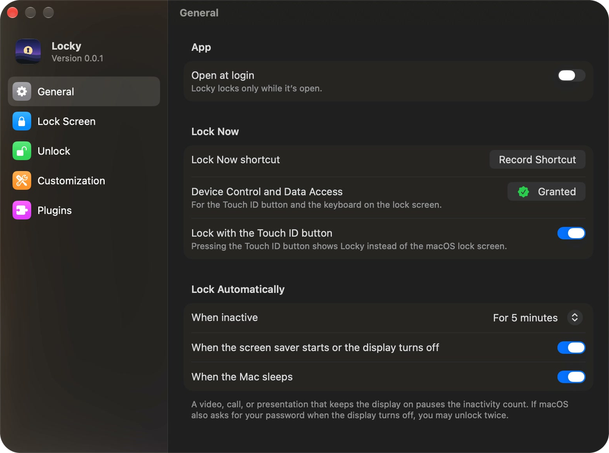

<h1 align="center">Locky</h1>

<h3 align="center">A lock screen for your Mac that you build yourself.</h3>

<p align="center">
  
</p>

Locky is a lock screen for macOS. It comes with 43 themes, and every theme and widget is a Lua file that you can change in the app or in your editor. Locky draws with SwiftUI and Metal, and it unlocks with Touch ID or your login password.

While Locky's lock shows, the macOS lock screen is off: Locky draws its own windows over your session. If Locky crashes, hangs, or is killed during a lock, a second process turns the macOS lock screen on within 8 seconds, and ⌃⌥⌘Q switches to it at any time. [security.md](docs/security.md) says what Locky guarantees and what it does not.

## Pick a theme

Themes… in the menu bar icon's menu opens the Themes window. It lists every theme, and shows the one in use live. Click a theme to use it, or move through the list with the arrow keys.

<p align="center">
  
</p>

Nine of the 43:

<p align="center">
  
</p>

<details>
<summary>All 43 themes</summary>

| Theme | id | Look |
|---|---|---|
| Bauhaus | `bauhaus` | A Bauhaus poster: red circle, blue half disc, yellow triangle, and the time in Futura. |
| Bento Cockpit | `bento` | A command-center bento grid: circular system gauges, a network chart, and a process list on graphite. |
| Braun | `braun` | Dieter Rams functionalism: a Braun analog clock hero, one yellow accent, quiet labelled blocks on warm grey. |
| Neo-Brutalism | `brutal` | Raw web blocks: thick borders, hard shadows, and clashing bright fills on cream, with a huge clock on lime. |
| Cassette Futurism | `cassette` | A 1970s mission console: green-and-amber phosphor on a scanlined CRT, with a warning lamp. |
| Glass Cockpit | `cockpit` | An aircraft PFD: artificial horizon, airspeed and altitude tapes, and magenta flight bugs. |
| Cyberdeck HUD | `cyberdeck` | A duotone vector cockpit: corner brackets, a glowing amber clock, and bracketed telemetry rails. |
| Deep Blue | `deepblue` | Underwater: rays of light, caustics, drifting plankton, and a whale gliding past. |
| Aurora | `default` | Northern lights over a mountain lake at night. Locky's default. |
| Departures | `departures` | A flip clock and a split-flap departures board of your herdr agents. |
| Dot Matrix | `dotmatrix` | A dot-matrix clock on a ghost dot grid: black, white, and one pulsing red dot. |
| Event Horizon | `eventhorizon` | A black hole with a turning accretion disk and light bent around its shadow. |
| Everforest | `everforest` | A cosy low-contrast forest: sand text, a rounded clock, a greeting, weather, and the day quietly passing. |
| Galaxy Sea | `galaxysea` | The Milky Way mirrored in a calm sea, a small boat on the horizon, and the odd meteor. |
| Liquid Glass | `glass` | A huge clock and glass gauges on your own wallpaper, after iOS 26 and macOS Tahoe. |
| Gruvbox | `gruvbox` | A conky sidebar in Gruvbox colors: system, disk, network, processes, and power beside a big clock. |
| Kanagawa | `kanagawa` | A woodblock Great Wave under an ink sky: a thin clock, a red seal, and a lot of calm space. |
| Liquid | `liquid` | Color folding into color like silk, a big clock, and a row of glass widgets. |
| Lookout | `lookout` | Layered ridges and a fire lookout in the light of the real time of day, from dawn to a starry night. |
| Material You | `material` | Material 3, colored by your wallpaper: soft rounded cards, a friendly clock, and pill chips. |
| Matrix | `matrix` | Digital rain, a glowing green clock, "Wake up, Neo…" typed in the corner, and the top processes. |
| Memento | `memento` | Memento mori: the day of the year, a dot for every day, and a stoic's word. |
| Mission | `mission` | A flight controller's console: mission elapsed time since lock, telemetry, UTC, and the downlink. |
| Mocha | `mocha` | Catppuccin Mocha with an i3lock-color ring. |
| Neon City | `neoncity` | A rainy city at 2 AM: towers drifting past, neon signs, flying cars, and a neon clock. |
| Nord | `nord` | Arctic frost: a cold flat gradient, a thin snow-white clock, and Scandinavian restraint. |
| Notebook | `notebook` | A ruled notebook page: the time in marker, your todo.txt by hand, a sticky note, and a coffee ring. |
| Observatory | `observatory` | A turning night sky over an observatory dome, with tonight's moon and the sun's path. |
| OP-1 | `op1` | A Teenage Engineering synth faceplate: hairline module panels, a tabular clock, meters, and a green OLED. |
| Phosphor | `phosphor` | An amber CRT terminal: a shell session with a block clock, neofetch, and herdr's agents. |
| Pocket | `pocket` | A four-shade handheld LCD: battery as hearts, a pixel clock, and the Game of Life. |
| Poster | `poster` | The time as a Swiss poster: huge numerals cropped by the edges, red overprinting black, small type on a grid. |
| Quantified Self | `quantified` | A wearable dashboard: near-black tiles, big scores, and rings in green-amber-red zones. |
| Rainy | `rainy` | A lo-fi rainy window: drops sliding down the glass, city lights out of focus, the time in words. |
| Rosé Pine | `rosepine` | Dusky soho minimalism: a serif clock, heavy negative space, one rose weather card, an iris quote. |
| Sakura | `sakura` | A cherry branch in bloom under the moon, falling petals, and the month's old Japanese name. |
| Snowfall | `snowfall` | Snow falling on a pine forest at night, and a cabin with warm windows and chimney smoke. |
| Station | `station` | A Swiss railway clock on a warm gray wall. The second hand sweeps, waits at 12, and the minute jumps. |
| Synthwave | `synthwave` | A neon sunset over a scrolling perspective grid, with a chrome clock. |
| Tokyo Night | `tokyonight` | The hyprlock look in Tokyo Night colors: split clock, weather, and status in the corners. |
| TUI Grid | `tui` | A btop terminal dashboard: bordered boxes with title tabs, a CPU chart, a neofetch host, and a teal clock. |
| Vaporwave | `vaporwave` | A pastel CRT dream: a banded sun, a cyan grid, VHS scanlines, and a chrome serif clock. |
| Word Clock | `wordclock` | The time spelled out on a letter grid. English only. |

</details>

Some themes are live wallpapers, drawn in Metal. They stop in Low Power Mode and with Reduce Motion on. Lookout follows the real time of day, from dawn to a starry night.

<p align="center">
  
</p>

Schedule (the clock in the Themes window's toolbar) changes the theme for you, by time of day or with Light and Dark mode.

## Change a theme

Customize… opens the editor on the theme's live lock screen. Click a widget or the password field to select it, and drag it to move it. Add Widget… shows a live gallery of the 27 widgets, in each of their sizes. The inspector changes what is selected, and the background, the colors, and the font.

<p align="center">
  
</p>

New Theme… (⌘N) starts a theme from a blank one. Every change is saved to `~/.config/locky/settings.json`, and Revert to Original takes a theme back.

## Lock and unlock

Lock Now is in the menu bar icon's menu. These are in Settings › General:

- **Lock Now shortcut:** record a shortcut that locks the Mac from any app.
- **Lock Automatically:** lock after a time without input, when the screen saver starts or the display turns off, and when the Mac sleeps.
- **Lock with the Touch ID button:** a press of the Touch ID button shows Locky's lock instead of the macOS lock screen. It is off by default, and it needs Accessibility access.

The Apple menu's Lock Screen and ⌃⌘Q still show the macOS lock screen. Locky does not change the macOS password setting.

A lock comes in with one of seven animations (Settings › Lock Screen). It ends only with Touch ID or your login password. Settings › Unlock can take a photo with the camera after wrong passwords.

## Make your own

A theme is a Lua file that places widgets on a background. A widget is a Lua function that returns views. You can write both by hand, or have a coding agent write them: Locky has a skill for Claude Code, Codex, and other agents.

```lua
-- ~/.config/locky/init.lua
locky.setup({ theme = "default", palette = { accent = "#ff79c6" } })
locky.pack.add({ "someone/locky-weather" })
```

Plugins are git repositories with themes, widgets, and shaders. Settings › Plugins installs, updates, and removes them. A plugin is code that runs as you, so install only plugins you trust.

- [create-theme.md](docs/create-theme.md): make a theme in the Themes window or in Lua, and share it
- [create-widget.md](docs/create-widget.md): write a widget, check it, draw it, and put it on the lock screen
- [agents.md](docs/agents.md): have a coding agent write widgets and themes for you

## Install

Install Locky in Terminal:

```sh
curl -fsSL https://raw.githubusercontent.com/InsaneArts/locky/main/install.sh | sh
```

It downloads the latest release, checks that Apple notarized it and that Locky's developer signed it, and puts Locky in Applications. To read the script before it runs, download it first:

```sh
curl -fsSL -o install-locky.sh https://raw.githubusercontent.com/InsaneArts/locky/main/install.sh
less install-locky.sh
sh install-locky.sh
```

Or with Homebrew:

```sh
brew trust insanearts/tap && brew install --cask insanearts/tap/locky
```

Homebrew loads casks from a tap outside its own only after you trust it. `brew install` then adds the tap by itself.

Or build Locky from a clone:

```sh
git clone https://github.com/InsaneArts/locky.git
cd locky
Scripts/package_app.sh        # builds Locky.app and installs it in /Applications
```

Requirements:

- macOS 15 or newer
- Xcode 26 or newer, to build

Open Locky from Applications. The first launch opens the Welcome, three short pages: a live preview with Lock Now, the switches that make Locky your lock screen, and what happens if something goes wrong.

Locky checks for a new version once a day and asks before it installs one. Locky › Check for Updates… checks at once. An update is installed only if its signature matches the key in Locky.

## Remove

1. In Settings › General, turn off Open at login. Then quit Locky from the menu bar icon's menu, and delete Locky.app.
2. Delete its files. `~/.config/locky` is your config, with the themes and widgets you made:

```sh
rm -rf ~/.config/locky ~/.local/share/locky
rm -rf ~/Library/Application\ Support/Locky ~/Library/Caches/Locky ~/Library/Logs/Locky
defaults delete com.tornikegomareli.Locky
```

3. If you gave Locky Accessibility access, remove it in System Settings › Privacy & Security › Accessibility with the − button.

If you installed the agent skill, delete its copies: `~/.claude/skills/locky`, `~/.codex/skills/locky`, and `~/.agents/skills/locky`.

## Using it

- Click the lock icon in the menu bar for Lock Now, Themes…, and Settings….
- On the lock screen, type your password, or use Touch ID.
- After 20 seconds without input, only the theme's background shows. A key or a mouse move brings the rest back.
- If something goes wrong on the lock screen, press ⌃⌥⌘Q to switch to the macOS lock screen.
- Help › Welcome to Locky opens the Welcome again.

## Settings



Settings… (⌘,) has five panes.

- **General:** Open at login, the Lock Now shortcut, Lock with the Touch ID button, and Lock Automatically.
- **Lock Screen:** a message under the password field, Hide personal information, the lock animation, and when the display turns off.
- **Unlock:** Touch ID, and a photo after wrong passwords.
- **Customization:** the config folder and init.lua, new themes and widgets, and the agent skill.
- **Plugins:** install, update, and remove plugins.

Everything but Open at login is saved to `~/.config/locky/settings.json`. It is plain JSON, so you can edit it by hand and keep it in your dotfiles. It wins over init.lua key by key: see [settings.md](docs/settings.md).

Hide personal information takes your name, your picture, the Mac's name, and your location off the lock screen.

<br clear="right" />

## Command line

The app's binary is also a command line (`/Applications/Locky.app/Contents/MacOS/Locky`):

```
locky check [--theme NAME] [--widget NAME]   run your config, plugins, and a theme; list every error
locky render --theme NAME --out FILE.png     the lock screen as a PNG, without a window; also --widget NAME,
                                             --size 1728x1117, --appearance light|dark,
                                             --transition lock|unlock --at 0.5 (the lock's animation),
                                             --style focus (or fade, iris, lift, sweep, dissolve, tiles)
locky health                                 like :checkhealth
locky themes | widgets                       what is installed
locky skill install | path                   Locky's skill for coding agents (docs/agents.md)
locky pack list|sync|update|clean            plugins from git, pinned by locky-pack-lock.json
locky pack check                             which plugins have updates; installs none
locky login [on|off]                         open Locky at login, or not
locky preview --theme NAME                   the lock screen in a window; --transition [STYLE] plays
                                             the lock's animation (Return plays it again)
locky window [SECTION]                       the Themes window, a Settings pane, or the Welcome
```

## Docs

- [security.md](docs/security.md): what the lock guarantees, what it does not, and how to report a vulnerability
- [settings.md](docs/settings.md): settings.json, which the windows write, and how it layers over init.lua
- [themes.md](docs/themes.md): themes, backgrounds, and shaders
- [widgets.md](docs/widgets.md): the core widgets and their options
- [plugins.md](docs/plugins.md): the plugin system, widgets, packages, health, and the safety rules
- [views.md](docs/views.md): every view and property widgets can draw
- [api.md](docs/api.md): the `locky` API

## Development

```sh
Scripts/package_app.sh            # builds Locky.app and installs it in /Applications (INSTALL=0 only builds)
swift test                        # the test suite
```

A build is signed ad hoc unless a `signing.env` next to `Package.swift` (ignored by git) names a certificate, for example `SIGNING_MODE=dev` and `APP_IDENTITY="Developer ID Application: Your Name (TEAMID)"`. macOS ties permissions such as Accessibility to the signature, so an ad-hoc build asks for them again after each build.

Locky has two package dependencies, both pinned exactly: [PermissionFlow](https://github.com/jaywcjlove/PermissionFlow) guides you through Accessibility, the camera, and Login Items in System Settings, and [Sparkle](https://sparkle-project.org) installs updates. [security.md](docs/security.md#the-two-dependencies) says what each one does. [release.md](docs/release.md) says how a release is made.

```
Sources/CLua/                 Lua 5.5.1 (unmodified) and locky_bridge.c: time budgets, memory limit, safe calls
Sources/Locky/Lua/            the runtime: LuaVM, LuaRuntime, the runtime path, system information
Sources/Locky/Views/          views, themes, backgrounds, widget hosts, the password field
Sources/Locky/Window/         the Themes window (the gallery and Customize), the Settings window and its panes,
                              the Welcome
Sources/Locky/Settings/       settings.json, its store, and the theme schedule
Sources/Locky/System/         the shortcut, auto-lock, login item, permissions, location, power, camera, editors,
                              updates, and the guard's Locky side
Sources/GuardCore/            the guard's watch and the macOS lock screen call, shared by Locky and locky-guard
Sources/LockyGuard/           locky-guard, which locks the Mac if Locky dies or hangs during a lock
Sources/Locky/Resources/
  runtime/                    lua/locky (core, ui), plugin/ (core widgets), themes/, shaders/, types/
  packages/                   the built-in theme packages, one folder each
Scripts/                      packaging, release.sh, snapshot.sh (a theme to PNG), window-shot.sh (a window to PNG),
                              thumbnails.sh (the theme thumbnails), make_icon.swift (the app icon)
releases/                     release notes, one Markdown file per version
Tests/LockyTests/             the test suite, and Fixtures/ (saved replies of the services widgets call)
Marketing/                    the launch film and its tools
```

## Credits

Weather data by [Open-Meteo.com](https://open-meteo.com), under [CC BY 4.0](https://creativecommons.org/licenses/by/4.0/). The weather and sun widgets use it. Locky › About Locky shows this credit too.
